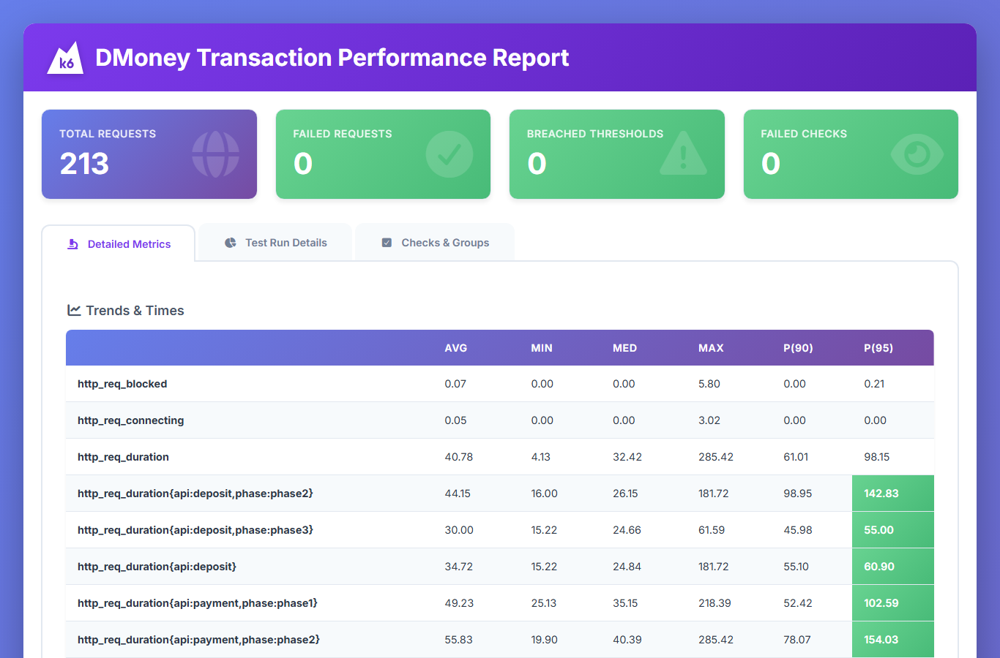
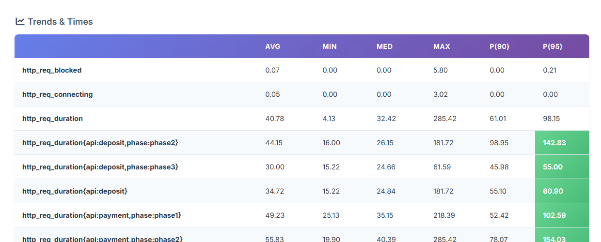

# DMoney Transaction Performance Test

A two-minute k6 workload for the local DMoney API. Six test identities authenticate with their own phone/password credentials, and each transaction uses the sender's token.

## Workload

| Time | Concurrent flows |
| --- | --- |
| 0-30s | Customer 1 sends money to Customer 2; Customer 2 pays Merchant 1 |
| 30-60s | Customer 2 sends money to Customer 1; Agent 1 deposits to Customer 2; Customer 1 pays Merchant 1 |
| 60-90s | Agent 1 deposits to Customer 1; Agent 2 deposits to Customer 2; Customer 1 sends money to Customer 2; Customer 2 pays Merchant 2 |
| 90-120s | Agent 1 and Customer 1 pay Merchant 1; Agent 2 and Customer 2 pay Merchant 2 |

Each flow runs concurrently in its assigned window with one VU and a two-second pause after each response. Authentication runs during setup and is excluded from transaction endpoint metrics. Requests use the configured `AMOUNT` (10 in the sample configuration); successful transactions change balances and transaction history and are not rolled back.

## Requirements and configuration

- Node.js and k6 installed and available on `PATH`.
- Internet access for k6 to download the `k6-reporter` HTML renderer from GitHub on first use.
- The DMoney API and MySQL running locally at `BASE_URL`.
- `K6/.env` configured from `.env.example` with the partner key, OTP, amount, and credentials for both agents, both customers, and both merchants.
- The API's local database driver installed for the guarded runner to temporarily raise and restore Customer transaction limits.

Do not commit `.env`, credentials, or local database backups. The script refuses non-local API URLs. The runner asks for confirmation before temporarily changing Customer daily/monthly limits; it restores and verifies the original values after the test, but it does not undo transaction effects.

## Run

From this folder in PowerShell:

```powershell
node .\run-k6-with-limits.mjs .\performance-test.js
```

When prompted, stop other API/UI/test traffic and enter `RAISE CUSTOMER LIMITS` to continue. The runner writes the HTML and sanitized JSON summary under `reports/`, plus a timestamped run directory with metadata. It verifies all six balances and planned Customer deposit capacity before the first transaction. A nonzero k6 exit can indicate a failed threshold; inspect the report and confirm `limitSettingsRestored` in the metadata.

If the runner is interrupted before restoring limits, recover them from this folder with:

```powershell
node .\run-k6-with-limits.mjs --restore
```

To rebuild the styled HTML dashboard from the existing sanitized summary without sending transactions:

```powershell
k6 run .\generate-report.js
```

The generated `performance-report.html` uses the k6-reporter dashboard.

## Assertions and thresholds

Each transaction checks HTTP 201, the expected success message, and a non-empty transaction ID. Global and per-API thresholds require:

- HTTP request failure rate below 1%.
- Transaction API p95 response time below 1000 ms.
- Transaction contract checks passing at least 99% of the time.

Deposit, Send Money, and Payment each have separate API thresholds; phase/API thresholds also verify coverage and make workload changes comparable.

## Results

Run `own-k6-2026-10-14T14-31-53-951Z` completed the full 120-second workload with exit code 0. All 13 scenarios ran for their assigned 30-second windows at two-second pacing. All 195 transaction requests completed; there were no interrupted iterations, HTTP failures, failed transaction checks, or breached thresholds. The runner restored and verified the original Customer limits. The 213 total HTTP requests also include authentication and balance preflight calls.

| API | Requests | Throughput (req/s) | Average (ms) | p95 (ms) | Failure rate | Contract pass |
| --- | ---: | ---: | ---: | ---: | ---: | ---: |
| Deposit | 45 | 0.750 | 34.72 | 60.90 | 0% | 100% |
| Send Money | 45 | 0.500 | 49.13 | 90.63 | 0% | 100% |
| Payment | 105 | 0.875 | 44.59 | 106.00 | 0% | 100% |

Throughput uses each API's active scheduled time (Deposit 60s, Send Money 90s, Payment 120s). Phase p95 values show where latency changed with the workload:

| Phase | Concurrent flows | Deposit p95 (ms) | Send Money p95 (ms) | Payment p95 (ms) |
| --- | ---: | ---: | ---: | ---: |
| 0-30s | 2 | N/A | 104.34 | 102.59 |
| 30-60s | 3 | 142.83 | 151.25 | 154.03 |
| 60-90s | 4 | 55.00 | 62.28 | 72.47 |
| 90-120s | 4 | N/A | N/A | 107.91 |

The highest phase/API p95 was 154.03 ms (Payment in phase 2). Latency rose in phase 2, then fell in phase 3 as concurrency increased to four flows; phase 4 Payment p95 remained below phase 2. No sustained degradation was observed, and all API p95s remained well below 1000 ms. These measurements describe this single local run, not a repeatability or production-capacity claim.

Detailed run output: [dashboard report](reports/own-k6-2026-10-14T14-31-53-951Z/performance-report.html) · [sanitized summary JSON](reports/own-k6-2026-10-14T14-31-53-951Z/summary.json).

### HTML report



### API and phase metrics



Raw run output: [`reports/`](reports/). Reference workload and report format: [Rejwana7/dmoney-k6-testing](https://github.com/Rejwana7/dmoney-k6-testing).
